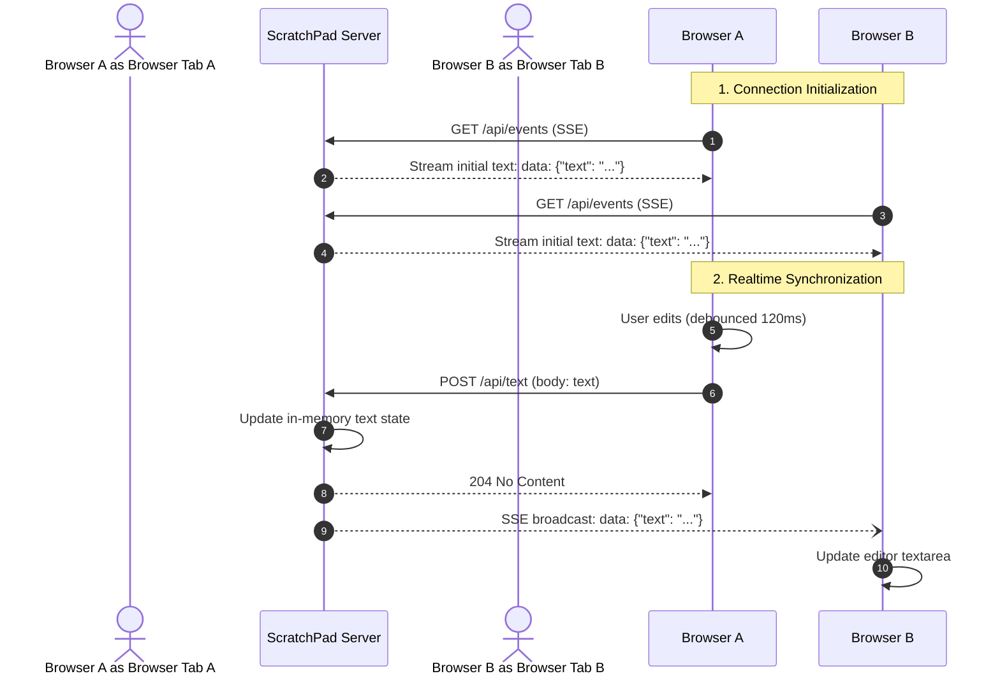

# ScratchPad

One shared text field, live in every browser that has it open. Type in one tab, see it in all the others. That is the whole product.

**English** | [Tiếng Việt](README.vi.md)

> ⚡ **Ultra-minimal container: ~2.4 MB compressed (6 MB on disk).** Built on `scratch` with a statically compiled Go binary and embedded static assets. Zero OS bloat, zero dependencies, instantaneous cold starts, non-root user.


<details>
  <summary>🌙 Click to view Dark Mode preview</summary>

  <br />

  
</details>

## Highlights & Features

- **Extreme lightweight deployment**: ~2.4 MB download footprint on Docker / GHCR, zero runtime dependencies, runs on empty `scratch` image
- **Realtime sync**: Synchronizes live across all connected browsers over Server-Sent Events (SSE)
- **Status indicator**: Visual connection feedback (green pulse when synced)
- **Light / Dark theme**: One-click toggle with system detection and persistence
- **Bilingual i18n**: Instant English / Tiếng Việt language switcher
- **Ergonomic UI**: Refined button paddings, character counter, and tactile states
- **One-click copy**: Clipboard copy with HTTP fallback (no HTTPS or localhost required)
- **Frontend stack**: React 19, Vite, Tailwind v4, shadcn/ui, and Lucide icons
- **Zero-dep local dev**: Supports both `node server.js` (standard Node `http`) and `go run server.go`

## Quick start

Run the tiny container directly from GitHub Container Registry:

```bash
docker run -d -p 8787:8787 ghcr.io/vnt87/scratchpad:latest
```

Open http://localhost:8787, then open the same URL in a second tab or device.

On a [Tailscale](https://tailscale.com) tailnet, publish the port and every device on your tailnet shares the same pad at `http://<tailscale-ip>:8787`.

Or use Compose:

```bash
docker compose up -d
```

## Image Size Comparison

| Container Build | Base Image | Size on Disk | Registry Download |
|---|---|---|---|
| **Original** | `node:22-alpine` | ~168 MB | ~62 MB |
| **Modular Alpine** | `alpine:latest` + Node | ~77 MB | ~29 MB |
| **ScratchPad Extreme (Current)** | `scratch` + Go static binary | **~6 MB** | **~2.4 MB** *(96% smaller)* |

## Development

You can run the backend with either Node.js or Go:

```bash
# 1. Install frontend dependencies
npm ci

# 2. Frontend dev server (Vite on :5173, proxies /api to :8787)
npm run dev

# 3. Production build
npm run build
npm run typecheck

# 4. Run production server
npm start          # Node.js backend (server.js)
# or:
go run server.go   # Go static backend (server.go)
```

## How it works

The server holds the active text in memory and maintains an open SSE connection per connected browser.

### Architecture Overview

```
┌────────────────────────────────────────────────────────┐
│                       BROWSER TABS                     │
│  ┌───────────────────────┐   ┌───────────────────────┐  │
│  │    Browser Tab A      │   │    Browser Tab B      │  │
│  │  (useSharedText hook) │   │  (useSharedText hook) │  │
│  └───────┬────────▲──────┘   └───────┬────────▲──────┘  │
└──────────┼────────┼──────────────────┼────────┼────────┘
     POST /api/text │            POST /api/text │
   (debounced 120ms)│          (debounced 120ms)│
           │   GET /api/events         │   GET /api/events
           │     (SSE Stream)          │     (SSE Stream)
           ▼        │                  ▼        │
┌───────────────────┴───────────────────────────┴────────┐
│           SCRATCHPAD SERVER (Go Static / Node.js)      │
│                                                        │
│  • In-Memory Text State (Protected with Mutex)         │
│  • SSE Broadcast Hub (Client Channels / Set)          │
│  • Embedded Static Assets (/dist Vite + React)         │
└────────────────────────────────────────────────────────┘
```



| Endpoint | Purpose |
| --- | --- |
| `GET /api/events` | Streams current text on connect, then broadcasts every change |
| `POST /api/text` | Updates the text and broadcasts to all listeners |
| `GET /*` | Serves embedded static assets (`dist/`) with immutable caching |

[`use-shared-text`](src/hooks/use-shared-text.ts) debounces local edits (120 ms) before posting and applies incoming frames to the textarea.

## Limitations, by design

- **Last-write-wins, not a CRDT.** Two people typing at the exact same moment overwrite each other. A local edit that has not been pushed yet is never replaced by an arriving frame, avoiding network echo.
- **In-memory only.** Restarting the container clears the pad.
- **No authentication.** Anyone who can reach the port can read and write it. Designed for a private network / tailnet, not the public internet.

## Configuration

| Variable | Default | Description |
| --- | --- | --- |
| `PORT` | `8787` | HTTP port the server binds to |

## Publishing

Pushing to `main` or tagging a release (`v1.2.3`) triggers
[Build and publish image](.github/workflows/build-and-publish.yml), which builds the multi-stage ~2.4 MB container and pushes `latest`, the branch name, the tag and a `sha-*` build to `ghcr.io/vnt87/scratchpad`.

## License

MIT
