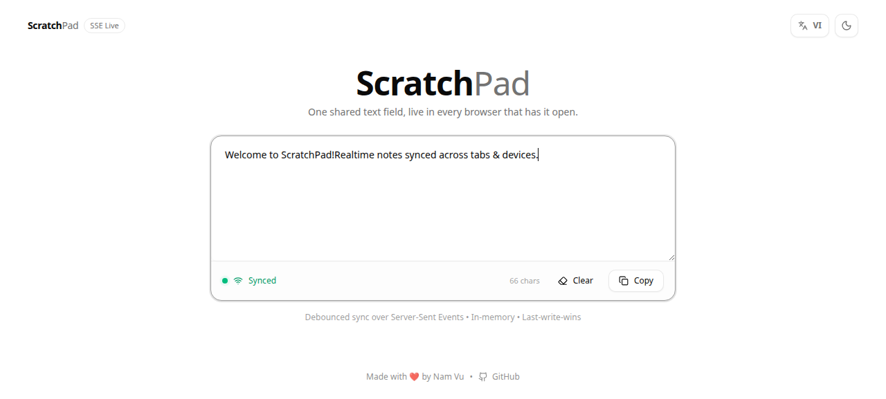
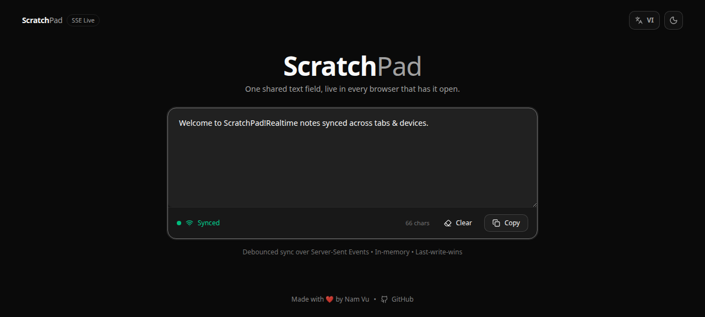

# ScratchPad

One shared text field, live in every browser that has it open. Type in one tab, see it in all the others. That is the whole product.

**English** | [Tiếng Việt](README.vi.md)



<details>
  <summary>🌙 Click to view Dark Mode preview</summary>

  <br />

  
</details>

## Features

- Realtime sync between every connected browser, over Server-Sent Events
- Live connection indicator (green pulse when synced)
- Built-in light / dark mode toggle with persistent preference and system detection
- Multilingual support with instant language toggle (English / Tiếng Việt)
- Comfortable button paddings and tactile states
- One-click copy, with a fallback that works on plain HTTP — no HTTPS or localhost required
- React 19, Vite, Tailwind v4, shadcn/ui and lucide-react on the front end
- Zero runtime dependencies on the back end — the sync API is Node's built-in `http`
- Single small container, no database, no build-time secrets

## Quick start

```bash
docker run -d -p 8787:8787 ghcr.io/vnt87/scratchpad:latest
```

Open http://localhost:8787, then open the same URL in a second tab or a second machine.

On a [Tailscale](https://tailscale.com) tailnet, publish the port and every device can share the
same pad at `http://<tailscale-ip>:8787`.

Or use Compose:

```bash
docker compose up -d
```

## Development

```bash
npm ci
npm run dev         # Vite on :5173, proxies /api to the Node server on :8787
npm start           # serve dist/ plus the sync API (run `npm run build` first)
npm run build
npm run typecheck
```

## How it works

`server.js` keeps the current text in memory and holds one open SSE connection per browser.

### Architecture Overview

```
┌────────────────────────────────────────────────────────┐
│                       BROWSER TABS                     │
│  ┌───────────────────────┐   ┌───────────────────────┐  │
│  │    Browser Tab A      │   │    Browser Tab B      │  │
│  │  (useSharedText hook) │   │  (useSharedText hook) │  │
│  └───────┬────────▲──────┘   └───────┬────────▲──────┘  │
└──────────┼────────┼──────────────────┼────────┼────────┘
     POST /api/text │            POST /api/text │
   (debounced 120ms)│          (debounced 120ms)│
           │   GET /api/events         │   GET /api/events
           │     (SSE Stream)          │     (SSE Stream)
           ▼        │                  ▼        │
┌───────────────────┴───────────────────────────┴────────┐
│               SCRATCHPAD SERVER (Node.js)              │
│                                                        │
│  • In-Memory Text State: `let text = ''`               │
│  • Client Set: `clients = Set<Response>()`             │
│  • Static File Serving: `/dist` (Vite + React)         │
└────────────────────────────────────────────────────────┘
```


| Endpoint | Purpose |
| --- | --- |
| `GET /api/events` | Streams the current text on connect, then every change |
| `POST /api/text` | Replaces the text with the request body and broadcasts to all listeners |
| `GET /*` | Serves the built React app from `dist/` |

[`use-shared-text`](src/hooks/use-shared-text.ts) debounces local edits (120 ms) before posting them
and applies incoming frames to the textarea.

## Limitations, by design

- **Last-write-wins, not a CRDT.** Two people typing at the same moment overwrite each other. A
  local edit that has not been pushed yet is never replaced by an arriving frame, so a fast typist
  does not lose characters to network echo.
- **In memory only.** Restarting the container clears the pad.
- **No authentication.** Anyone who can reach the port can read and write it. This is meant for a
  private network, not the public internet.

## Configuration

| Variable | Default | Description |
| --- | --- | --- |
| `PORT` | `8787` | HTTP port the server binds to |

## Publishing

Pushing to `main` or tagging a release (`v1.2.3`) triggers
[Build and publish image](.github/workflows/build-and-publish.yml), which builds the container and
pushes `latest`, the branch name, the tag and a `sha-*` build to `ghcr.io/vnt87/scratchpad`.

## License

MIT
