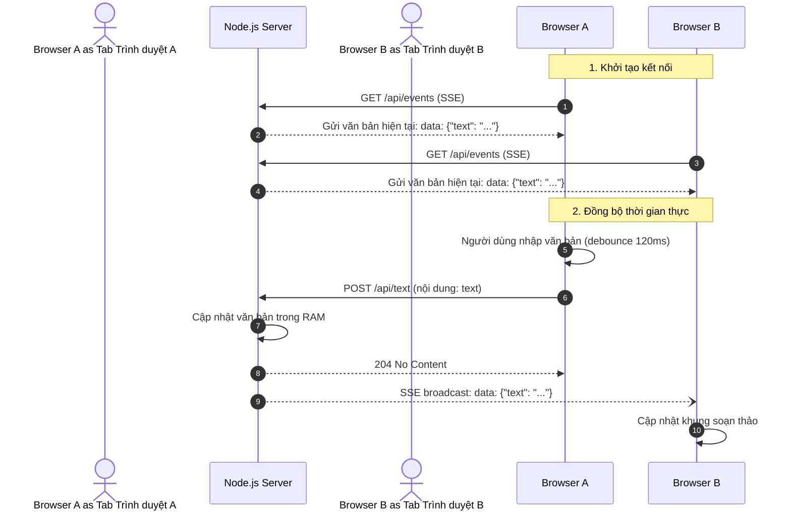

# ScratchPad

Một khung văn bản dùng chung, trực tiếp trên mọi trình duyệt đang mở. Gõ ở một tab, thấy ngay ở tất cả các tab khác. Toàn bộ sản phẩm chỉ có vậy.

[English](README.md) | **Tiếng Việt**


<details>
  <summary>🌙 Nhấn để xem giao diện Tối (Dark Mode)</summary>

  <br />

  
</details>

## Tính năng

- Đồng bộ thời gian thực giữa mọi trình duyệt đang kết nối qua Server-Sent Events
- Trạng thái kết nối trực quan (đèn xanh báo hiệu khi đã đồng bộ)
- Tích hợp chuyển đổi giao diện sáng / tối (light/dark mode) với bộ nhớ lưu trữ và tự nhận diện hệ điều hành
- Hỗ trợ đa ngôn ngữ với nút chuyển đổi tức thì (English / Tiếng Việt)
- Khoảng đệm (padding) nút bấm thoải mái, phản hồi tương tác mượt mà
- Sao chép 1 chạm với cơ chế dự phòng hoạt động trên HTTP thường — không cần HTTPS hay localhost
- Frontend dùng React 19, Vite, Tailwind v4, shadcn/ui và lucide-react
- Backend không có dependency bên ngoài — sync API dùng module `http` có sẵn của Node.js
- Container đơn gọn nhẹ, không cần cơ sở dữ liệu, không cần secret khi build

## Khởi động nhanh

```bash
docker run -d -p 8787:8787 ghcr.io/vnt87/scratchpad:latest
```

Mở http://localhost:8787, sau đó mở cùng đường dẫn ở tab thứ hai hoặc thiết bị khác.

Trên mạng [Tailscale](https://tailscale.com), mở cổng này và mọi thiết bị trong mạng tailnet đều có thể dùng chung bảng ghi chú tại `http://<tailscale-ip>:8787`.

Hoặc dùng Docker Compose:

```bash
docker compose up -d
```

## Phát triển

```bash
npm ci
npm run dev         # Vite chạy trên :5173, proxy /api sang Node server ở :8787
npm start           # phục vụ thư mục dist/ và sync API (cần chạy `npm run build` trước)
npm run build
npm run typecheck
```

## Cơ chế hoạt động

`server.js` lưu trữ nội dung văn bản hiện tại trong bộ nhớ RAM và duy trì một kết nối SSE mở cho mỗi trình duyệt.

### Sơ đồ kiến trúc

```
┌────────────────────────────────────────────────────────┐
│                   CÁC TAB TRÌNH DUYỆT                  │
│  ┌───────────────────────┐   ┌───────────────────────┐  │
│  │     Tab Trình duyệt A │   │     Tab Trình duyệt B │  │
│  │  (hook useSharedText) │   │  (hook useSharedText) │  │
│  └───────┬────────▲──────┘   └───────┬────────▲──────┘  │
└──────────┼────────┼──────────────────┼────────┼────────┘
     POST /api/text │            POST /api/text │
   (debounce 120ms) │          (debounce 120ms) │
           │   GET /api/events         │   GET /api/events
           │     (Luồng SSE)           │     (Luồng SSE)
           ▼        │                  ▼        │
┌───────────────────┴───────────────────────────┴────────┐
│               SCRATCHPAD SERVER (Node.js)              │
│                                                        │
│  • Trạng thái văn bản trong RAM: `let text = ''`       │
│  • Danh sách kết nối: `clients = Set<Response>()`      │
│  • Phục vụ static file: `/dist` (Vite + React build)   │
└────────────────────────────────────────────────────────┘
```



| Điểm cuối (Endpoint) | Mục đích |
| --- | --- |
| `GET /api/events` | Truyền luồng văn bản hiện tại khi kết nối và mỗi khi có thay đổi |
| `POST /api/text` | Thay thế văn bản bằng nội dung yêu cầu và phát thông báo đến mọi listener |
| `GET /*` | Phục vụ ứng dụng React đã build từ thư mục `dist/` |

[`use-shared-text`](src/hooks/use-shared-text.ts) khử rung các chỉnh sửa cục bộ (120 ms) trước khi gửi lên máy chủ và áp dụng các cập nhật nhận về vào ô soạn thảo.

## Giới hạn theo thiết kế

- **Last-write-wins, không phải CRDT.** Hai người gõ cùng một thời điểm sẽ ghi đè lên nhau. Chỉnh sửa cục bộ chưa đẩy lên sẽ không bao giờ bị ghi đè bởi frame gửi về, do đó người gõ nhanh không bị mất chữ bởi độ trễ mạng.
- **Chỉ lưu trên bộ nhớ RAM.** Khởi động lại container sẽ đặt lại nội dung bảng trắng.
- **Không có xác thực.** Bất kỳ ai truy cập được vào cổng đều có thể đọc và ghi. Ứng dụng được thiết kế cho mạng nội bộ cá nhân, không phải internet công cộng.

## Cấu hình

| Biến | Mặc định | Mô tả |
| --- | --- | --- |
| `PORT` | `8787` | Cổng HTTP mà server lắng nghe |

## Xuất bản Docker Image

Đẩy mã lên nhánh `main` hoặc gắn thẻ phiên bản (`v1.2.3`) sẽ kích hoạt
[Build and publish image](.github/workflows/build-and-publish.yml), tự động build container và
đẩy `latest`, tên nhánh, tag và `sha-*` lên `ghcr.io/vnt87/scratchpad`.

## Giấy phép

MIT
