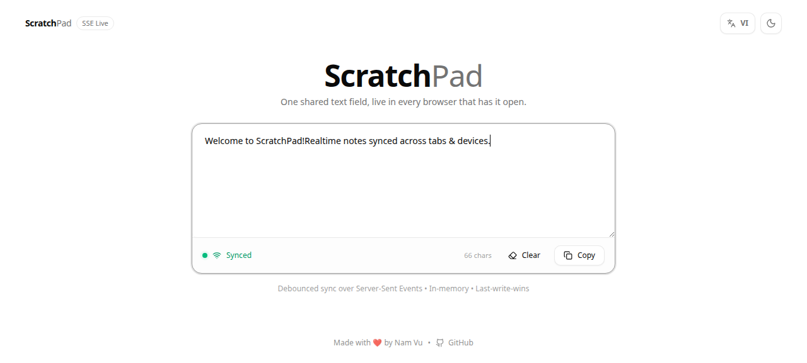
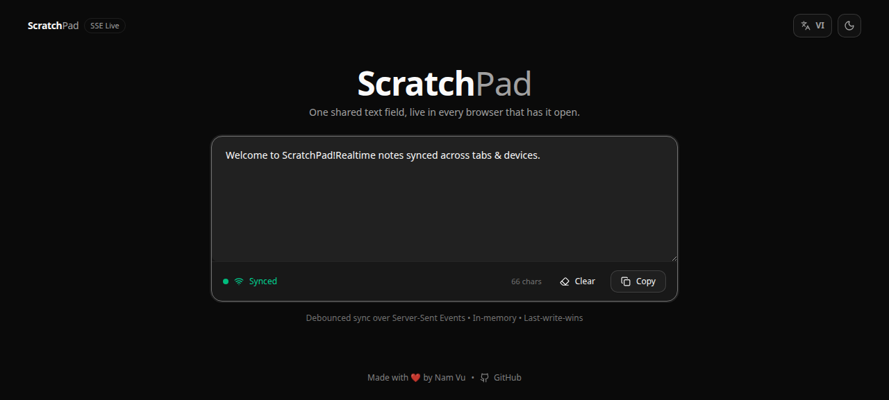

# ScratchPad

Một khung văn bản dùng chung, trực tiếp trên mọi trình duyệt đang mở. Gõ ở một tab, thấy ngay ở tất cả các tab khác. Toàn bộ sản phẩm chỉ có vậy.

[English](README.md) | **Tiếng Việt**

> ⚡ **Container siêu tối giản: ~2.4 MB khi tải về (6 MB trên ổ đĩa).** Xây dựng trên nền `scratch` rỗng với binary Go biên dịch tĩnh và nhúng toàn bộ web assets. Không thừa thãi hệ điều hành, không dependency phụ thuộc, khởi động tức thì, chạy với quyền non-root bảo mật.



<details>
  <summary>🌙 Nhấn để xem giao diện Tối (Dark Mode)</summary>

  <br />

  
</details>

## Điểm nhấn & Tính năng

- **Kích thước container siêu nhẹ**: Chỉ ~2.4 MB tải về từ Docker / GHCR, không dependency runtime, chạy trực tiếp trên image `scratch`
- **Đồng bộ thời gian thực**: Đồng bộ trực tiếp giữa mọi trình duyệt đang kết nối qua Server-Sent Events (SSE)
- **Trạng thái kết nối trực quan**: Đèn báo hiệu nhấp nháy xanh lá khi đã kết nối đồng bộ
- **Giao diện sáng / tối**: Nút bấm chuyển đổi nhanh, tự nhận diện hệ điều hành và lưu cấu hình vào `localStorage`
- **Hỗ trợ song ngữ**: Chuyển đổi ngôn ngữ tức thời (English / Tiếng Việt)
- **Thiết kế tối ưu**: Khoảng đệm (padding) nút bấm cân đối, bộ đếm ký tự và hiệu ứng phản hồi mượt mà
- **Sao chép 1 chạm**: Sao chép clipboard có fallback hỗ trợ cả HTTP thường (không cần HTTPS hay localhost)
- **Công nghệ frontend**: React 19, Vite, Tailwind v4, shadcn/ui và icon Lucide
- **Lập trình nội bộ linh hoạt**: Hỗ trợ chạy bằng cả `node server.js` (không cần cài thêm npm package ngoài) lẫn `go run server.go`

## Khởi động nhanh

Khởi chạy container siêu nhẹ trực tiếp từ GitHub Container Registry:

```bash
docker run -d -p 8787:8787 ghcr.io/vnt87/scratchpad:latest
```

Mở http://localhost:8787, sau đó mở cùng đường dẫn ở tab thứ hai hoặc thiết bị khác.

Trên mạng [Tailscale](https://tailscale.com), mở cổng này và mọi thiết bị trong mạng tailnet đều có thể dùng chung bảng ghi chú tại `http://<tailscale-ip>:8787`.

Hoặc dùng Docker Compose:

```bash
docker compose up -d
```

## So sánh kích thước Docker Image

| Phiên bản đóng gói | Base Image | Dung lượng ổ đĩa | Dung lượng tải về (Registry) |
|---|---|---|---|
| **Bản gốc** | `node:22-alpine` | ~168 MB | ~62 MB |
| **Alpine rút gọn** | `alpine:latest` + Node | ~77 MB | ~29 MB |
| **ScratchPad Extreme (Hiện tại)** | `scratch` + Go static binary | **~6 MB** | **~2.4 MB** *(Nhẹ hơn 96%)* |

## Phát triển

Bạn có thể chạy backend bằng Node.js hoặc Go tuỳ chọn:

```bash
# 1. Cài đặt thư viện frontend
npm ci

# 2. Khởi chạy Vite dev server (:5173, tự động proxy /api sang :8787)
npm run dev

# 3. Build bản phát hành
npm run build
npm run typecheck

# 4. Chạy server
npm start          # Backend Node.js (server.js)
# hoặc:
go run server.go   # Backend Go static (server.go)
```

## Cơ chế hoạt động

Server lưu trữ nội dung văn bản hiện tại trong bộ nhớ RAM và duy trì một kết nối SSE mở cho mỗi trình duyệt.

### Sơ đồ kiến trúc

```
┌────────────────────────────────────────────────────────┐
│                   CÁC TAB TRÌNH DUYỆT                  │
│  ┌───────────────────────┐   ┌───────────────────────┐  │
│  │     Tab Trình duyệt A │   │     Tab Trình duyệt B │  │
│  │  (hook useSharedText) │   │  (hook useSharedText) │  │
│  └───────┬────────▲──────┘   └───────┬────────▲──────┘  │
└──────────┼────────┼──────────────────┼────────┼────────┘
     POST /api/text │            POST /api/text │
   (debounce 120ms) │          (debounce 120ms) │
           │   GET /api/events         │   GET /api/events
           │     (Luồng SSE)           │     (Luồng SSE)
           ▼        │                  ▼        │
┌───────────────────┴───────────────────────────┴────────┐
│         SCRATCHPAD SERVER (Go Static / Node.js)        │
│                                                        │
│  • Quản lý văn bản trong RAM (khoá an toàn Mutex)      │
│  • Kênh phân phối SSE (Hub quản lý các kết nối)        │
│  • Nhúng sẵn toàn bộ assets tĩnh (/dist Vite + React)  │
└────────────────────────────────────────────────────────┘
```


| Điểm cuối (Endpoint) | Mục đích |
| --- | --- |
| `GET /api/events` | Truyền luồng văn bản hiện tại khi kết nối và phát thông báo khi có thay đổi |
| `POST /api/text` | Cập nhật văn bản và phát thông báo đến mọi listener |
| `GET /*` | Phục vụ trực tiếp các file tĩnh nhúng sẵn (`dist/`) với bộ nhớ đệm immutable |

[`use-shared-text`](src/hooks/use-shared-text.ts) khử rung các chỉnh sửa cục bộ (120 ms) trước khi gửi lên máy chủ và áp dụng các cập nhật nhận về vào ô soạn thảo.

## Giới hạn theo thiết kế

- **Last-write-wins, không phải CRDT.** Hai người gõ cùng một thời điểm sẽ ghi đè lên nhau. Chỉnh sửa cục bộ chưa đẩy lên sẽ không bao giờ bị ghi đè bởi frame gửi về, do đó người gõ nhanh không bị mất chữ bởi độ trễ mạng.
- **Chỉ lưu trên bộ nhớ RAM.** Khởi động lại container sẽ đặt lại nội dung bảng trắng.
- **Không có xác thực.** Bất kỳ ai truy cập được vào cổng đều có thể đọc và ghi. Ứng dụng được thiết kế cho mạng nội bộ cá nhân, không phải internet công cộng.

## Cấu hình

| Biến | Mặc định | Mô tả |
| --- | --- | --- |
| `PORT` | `8787` | Cổng HTTP mà server lắng nghe |

## Xuất bản Docker Image

Đẩy mã lên nhánh `main` hoặc gắn thẻ phiên bản (`v1.2.3`) sẽ kích hoạt
[Build and publish image](.github/workflows/build-and-publish.yml), tự động build container dung lượng siêu nhỏ ~2.4 MB và
đẩy `latest`, tên nhánh, tag và `sha-*` lên `ghcr.io/vnt87/scratchpad`.

## Giấy phép

MIT
